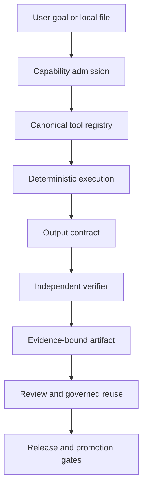

# FLIXO Hub

<p align="center">
  <strong>Private-by-design workflows. Verifiable AI tools. Governed autonomous development.</strong>
</p>

<p align="center">
  <a href="https://flixoai.vercel.app/">Product</a> ·
  <a href="https://github.com/m1m2m3m4m5m6m700-afk/FLIXO_Hub/tree/execution/docs">Documentation</a> ·
  <a href="https://github.com/m1m2m3m4m5m6m700-afk/FLIXO_Hub/issues">Issues</a> ·
  <a href="https://github.com/m1m2m3m4m5m6m700-afk/FLIXO_Hub/discussions">Discussions</a> ·
  <a href="https://github.com/m1m2m3m4m5m6m700-afk/FLIXO_Hub/blob/execution/CONTRIBUTING.md">Contribute</a>
</p>

<p align="center">
  
  
  
  
</p>

<p align="center">
  <a href="https://github.com/m1m2m3m4m5m6m700-afk/FLIXO_Hub/actions/workflows/ci.yml"></a>
  <a href="https://github.com/m1m2m3m4m5m6m700-afk/FLIXO_Hub/commits/execution"></a>
  <a href="https://github.com/m1m2m3m4m5m6m700-afk/FLIXO_Hub/issues"></a>
  <a href="https://github.com/m1m2m3m4m5m6m700-afk/FLIXO_Hub/blob/execution/SECURITY.md"></a>
</p>

---

## The vision

**FLIXO Hub is an open-source, browser-first AI toolbox and a governed developer platform.** It brings privacy-preserving file workflows, deterministic tool execution, collaborative workspaces, and multi-agent engineering under one auditable system.

The central idea is simple: **capabilities should be reusable only when their behavior has been verified, and authority should always be explicit.** A successful build is useful evidence, not a release certificate.

## One platform, two connected surfaces

<table>
  <tr>
    <td width="50%" valign="top">
      <h3>🛠️ Local-first AI toolbox</h3>
      Build and run supported file and media workflows in the browser. The MVP's local editing path keeps raw user `File`/`Blob` bytes out of LLMs, external providers, and backends.
      <p><a href="https://flixoai.vercel.app/">Open FLIXO Hub →</a></p>
    </td>
    <td width="50%" valign="top">
      <h3>🧭 Governed developer platform</h3>
      Organize projects, workspaces, agents, tools, artifacts, collaboration, and contributions with explicit execution policies and verifiable evidence.
      <p><a href="https://github.com/m1m2m3m4m5m6m700-afk/FLIXO_Hub/tree/execution/src/pages">Explore platform source →</a></p>
    </td>
  </tr>
</table>

## How the system fits together



The intended authority chain is deliberately singular: canonical capability definitions feed the tool registry/catalog, which routes execution through the canonical executor, output-contract assertions, and capability verification. Agents may propose and implement changes within their permissions; they do not self-certify releases or bypass promotion controls.

## What makes FLIXO different

- **Privacy-first processing:** raw local file bytes stay on the browser-local MVP path.
- **Deterministic tools:** canonical executors, output contracts, and verifiers make supported operations testable.
- **Governed agents:** CELL workflows use explicit capability, ownership, opposition, and evidence boundaries.
- **SHA-bound evidence:** test, security, browser, and release evidence must identify the exact source revision it validates.
- **Honest infrastructure boundaries:** the developer platform does not pretend a remote execution provider exists until one is configured and admitted.
- **Fail-closed security:** secrets remain server-side; the canonical static Worker intentionally rejects unsupported `/api/*` routes.

## Architecture at a glance

| Area | Responsibility |
| --- | --- |
| `src/config` | Canonical capability definitions and the single tool registry/catalog |
| `src/lib` | Planning, canonical execution, output contracts, verifiers, security boundaries, routing, and runtime |
| `src/tools` | User-facing tools and browser-local processing engines |
| `src/worker.ts` | Static Worker boundary, security headers, and source-identity verification |
| `src/pages/developer-platform.tsx` | Governed developer-platform interface |
| `supabase` | Persistence configuration for non-MVP surfaces |

**Technology:** React 19, Vite, TypeScript, browser APIs, Cloudflare Workers, Playwright, and a governed tool-verification pipeline.

## Current project status

FLIXO Hub is actively developed on `execution`. The intended production path is **`execution → main`**, through protected automation and required evidence gates.

> **Release integrity:** This README does not claim that the current repository is certified or production-ready. Release status must be established from current CI, security, Red Team, production identity, and browser acceptance evidence, all bound to the same exact release SHA.

Track the actual signals here:

- [CI workflow and run history](https://github.com/m1m2m3m4m5m6m700-afk/FLIXO_Hub/actions/workflows/ci.yml)
- [All GitHub Actions runs](https://github.com/m1m2m3m4m5m6m700-afk/FLIXO_Hub/actions)
- [Open issues](https://github.com/m1m2m3m4m5m6m700-afk/FLIXO_Hub/issues?q=is%3Aissue+is%3Aopen)
- [Good first issues](https://github.com/m1m2m3m4m5m6m700-afk/FLIXO_Hub/issues?q=is%3Aissue+is%3Aopen+label%3A%22good+first+issue%22)
- [Help wanted](https://github.com/m1m2m3m4m5m6m700-afk/FLIXO_Hub/issues?q=is%3Aissue+is%3Aopen+label%3A%22help+wanted%22)
- [Release manifest](https://github.com/m1m2m3m4m5m6m700-afk/FLIXO_Hub/blob/execution/docs/FLIXO-PUBLIC-RELEASE-MANIFEST.md)
- [Public launch execution plan](https://github.com/m1m2m3m4m5m6m700-afk/FLIXO_Hub/blob/execution/docs/FLIXO-PUBLIC-LAUNCH-EXECUTION-PLAN.md)

## Run it locally

Requirements: Node.js compatible with the repository's declared engine and npm.

```bash
git clone https://github.com/m1m2m3m4m5m6m700-afk/FLIXO_Hub.git
cd FLIXO_Hub
npm ci
npm run dev
```

Before proposing a release, run the relevant checks:

```bash
npm test
npm run build
npm run test:e2e
```

Consult the current CI configuration for the authoritative check set and supported runtime versions.

## Privacy and browser-local MVP

The admitted MVP workflows are:

1. **Agent-guided workflow:** local file + instruction → deterministic plan → explicit confirmation → canonical local execution → verifier → artifact.
2. **Manual workflow:** direct tool route → local file input → canonical local execution → verifier → artifact.

The Hub's local-processing surface uses browser Worker messaging and browser capabilities with a session-memory fallback where supported. OCR remains blocked until self-hosted worker, core, and language assets are admitted and verified. Do not assume that every planned capability is already enabled.

## Contribute to the project

1. Read [CONTRIBUTING.md](https://github.com/m1m2m3m4m5m6m700-afk/FLIXO_Hub/blob/execution/CONTRIBUTING.md).
2. Review the architecture and relevant repository contracts before changing execution or governance code.
3. Choose a scoped task from [open issues](https://github.com/m1m2m3m4m5m6m700-afk/FLIXO_Hub/issues).
4. Submit a pull request with reproducible checks and evidence appropriate to the change.

Use [Discussions](https://github.com/m1m2m3m4m5m6m700-afk/FLIXO_Hub/discussions) for questions and architecture proposals. Report security-sensitive findings through the private process in [SECURITY.md](https://github.com/m1m2m3m4m5m6m700-afk/FLIXO_Hub/blob/execution/SECURITY.md), not in public issues.

## Project policies and resources

- [Documentation index](https://github.com/m1m2m3m4m5m6m700-afk/FLIXO_Hub/tree/execution/docs)
- [Contribution contract](https://github.com/m1m2m3m4m5m6m700-afk/FLIXO_Hub/blob/execution/docs/CONTRIBUTIONS.md)
- [Support](https://github.com/m1m2m3m4m5m6m700-afk/FLIXO_Hub/blob/execution/SUPPORT.md)
- [Accessibility](https://github.com/m1m2m3m4m5m6m700-afk/FLIXO_Hub/blob/execution/ACCESSIBILITY.md)
- [License](https://github.com/m1m2m3m4m5m6m700-afk/FLIXO_Hub/blob/execution/LICENSE)
- [Citation metadata](https://github.com/m1m2m3m4m5m6m700-afk/FLIXO_Hub/blob/execution/CITATION.cff)

## Licensing

**License metadata requires maintainer reconciliation before release.** The current `LICENSE` file contains AGPL-3.0 text, while `CITATION.cff` declares Apache-2.0 and the legal blocker ledger says the intended repository license has not been confirmed. Do not infer a settled license from these conflicting files. See [the release readiness plan](https://github.com/m1m2m3m4m5m6m700-afk/FLIXO_Hub/blob/chore/release-readiness-plan-20261015/docs/FLIXO-PUBLIC-LAUNCH-EXECUTION-PLAN.md) and [LICENSE](LICENSE).

---

<p align="center">
  <strong>Discover. Build. Verify. Reuse.</strong><br />
  <sub>Open source · Privacy-first · Evidence-driven</sub>
</p>
